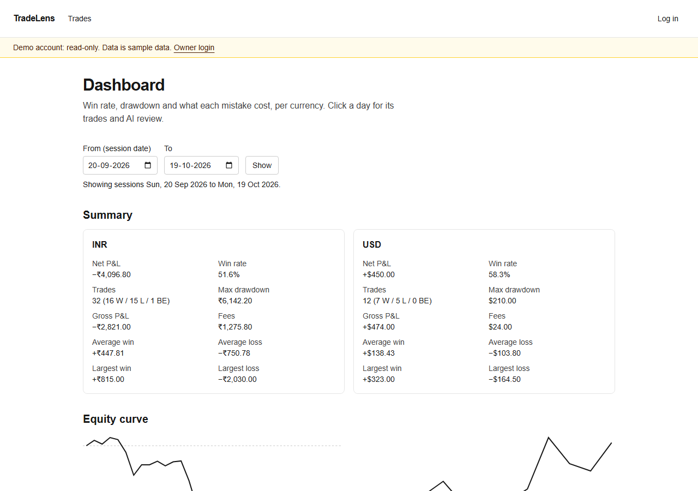
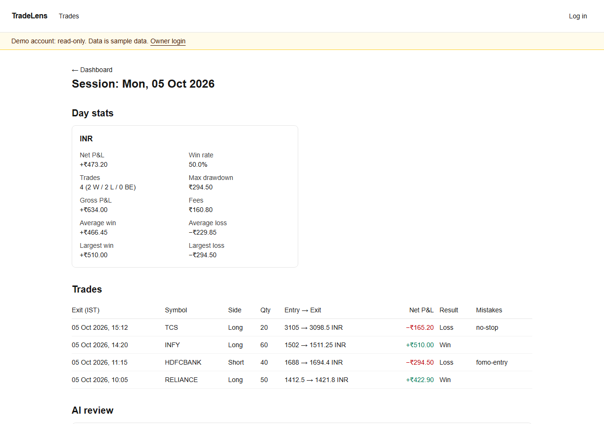

# TradeLens: an AI trade journal

**Live demo:** https://tradelens-jade-nu.vercel.app (read-only demo account, no login needed)

Log closed trades, see win rate, drawdown and what each mistake cost, and get an AI review of each trading day that groups mistakes by type and points at the trades behind them.





## What it does

- **Trades:** create, edit and delete closed trades, with IST times stored as UTC and up to 10 mistake tags (F4).
- **Stats:** net/gross P&L, win rate, average win/loss, max drawdown and P&L per mistake tag, per currency. All numbers come from tested TypeScript functions, never from the model (F5, D9).
- **Dashboard and session pages:** server-rendered, with equity curves that have text alternatives, and no serious axe violations (F6).
- **AI session review:** Claude returns a structured JSON review (Zod schema + structured outputs). Code checks that every trade id it cites exists and every tagged mistake is covered. Invalid output gets one retry, then a clear error; nothing invalid is saved (F7).
- **Demo mode:** logged-out visitors see seeded sample data and cannot write anything or trigger an AI call (F8).

## How it was built

This is a spec-driven project built with an AI coding agent:

- [`SPEC.md`](SPEC.md) has numbered decisions (D1–D17) and features (F1–F10), each with acceptance criteria and the test type that proves it.
- [`AGENTS.md`](AGENTS.md) holds the rules the agent must follow, including rules added after real bugs.
- Each feature landed as one PR with CI green before merge.

## Stack

Next.js 16 (App Router), React 19, TypeScript (strict), Tailwind v4, Neon Postgres + Drizzle, Zod, Anthropic SDK, Vitest, Playwright + axe, GitHub Actions, Vercel (Singapore region, next to the database).

## Testing approach

| Layer | Tool | What it proves |
| --- | --- | --- |
| Unit | Vitest | Stats, time zones, validation, review grounding checks, model selection |
| Integration | Vitest + a Neon **test branch** | Real SQL: constraints, seed data, stats against the DB. The branch is wiped and reseeded each run, and the code refuses to run if it points at production |
| End-to-end | Playwright (production build, `TZ=UTC`, mock AI) | Auth, CRUD, dashboard numbers vs. a fixture, AI retry/failure paths, demo mode, accessibility |
| Live smoke | Playwright `@prod` tag | 17 read-only checks against the deployed site |
| Evals | `npm run eval` | The real model on 5 fixed days, graded by code (see [`EVALS.md`](EVALS.md)) |

Tests were checked by breaking the code on purpose (mutation checks) to make sure they fail when they should. Retries are off, so a flaky test fails instead of hiding.

**Honest note on AI (SPEC D17):** this demo has no paid API budget. The reviews on the live demo are pre-written samples, labelled as samples, that pass the same grounding checks as live output. The live pipeline is fully built and tested with a mock model; the live evals have not been run yet.

## Run locally

Requires Node 26 and two Neon databases (or branches): one for the app, one for tests.

```bash
git clone https://github.com/rishabhmishraaa/tradelens.git
cd tradelens
npm install
cp .env.example .env.local   # then fill in the values below
npm run hash-password -- "a long password of your choice"   # paste the output into OWNER_PASSWORD_HASH
npm run db:migrate
npm run db:seed
npm run dev
```

### Environment variables

| Name | Needed for | Notes |
| --- | --- | --- |
| `DATABASE_URL` | the app | Neon connection string |
| `TEST_DATABASE_URL` | `npm test`, E2E | A **different** database; it gets wiped |
| `OWNER_PASSWORD_HASH` | logging in | From `npm run hash-password` |
| `SESSION_SECRET` | logging in | 32+ random characters |
| `ANTHROPIC_API_KEY`, `ANTHROPIC_MODEL` | live AI reviews, evals | Optional; without them, Generate shows a clear error |
| `AI_MODE` | tests | `mock` uses the fake model; refused in production |

### Commands

```bash
npm run lint && npm run typecheck
npm test                 # unit + integration
npm run test:e2e         # build + Playwright
BASE_URL=https://tradelens-jade-nu.vercel.app npx playwright test   # @prod smoke tests only
npm run eval:dry         # eval harness with the mock model
```
